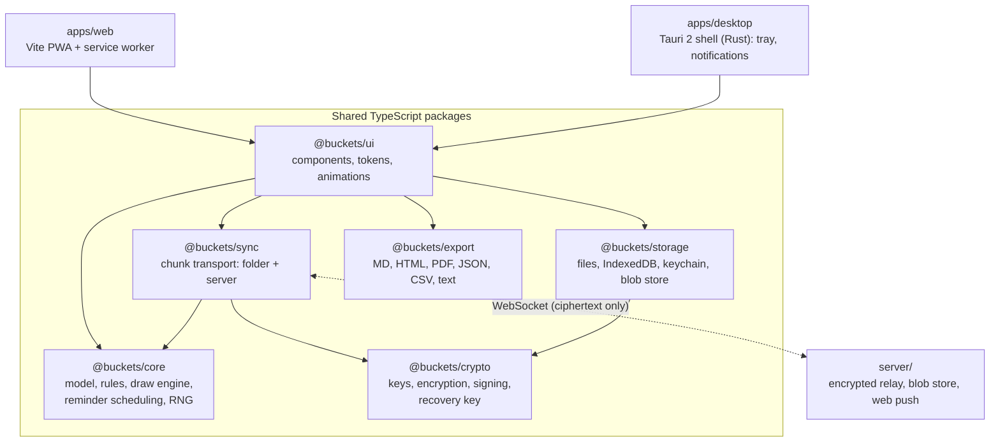

# Buckets — Project Plan

| | |
|---|---|
| **Status** | Draft v0.7 (M0 complete; M1 draw engine built in `@buckets/core`) |
| **Last updated** | 2026-10-30 |
| **Platforms** | Web (offline-capable PWA), Windows 10 21H2+ / 11, macOS 12+, Linux: Ubuntu 22.04+, Fedora 39+, or equivalent (x64 + arm64) |
| **Stack** | Tauri 2 + React + TypeScript, Automerge (CRDT), end-to-end encrypted sync |
| **License** | Apache-2.0 (apps and packages) · AGPL-3.0-only (`server/`) |

### Changes in v0.7

- M0 is complete: the empty window has been checked by hand on macOS, Windows and Linux (§15).
- M1 is built in `packages/core`: the data model, presets, commands, derived state, the draw and resolve functions, reminder scheduling, history compaction and the migration mechanism. §5–§8 now record the decisions M1 had to make: the `Duration` type, the `draw` and `resolve` call shapes, the RRULE subset, the compaction baseline and how migrations work.
- Daily Draw now draws 2 items at a time (decision 14), the prototype moved to `docs/prototype/` (decision 15), and `autoReturnAt` is worked out while reading, with no events written (decision 16, §6.2).

### Changes in v0.6

- M0 foundations are built: pnpm workspace with package stubs, strict TypeScript, ESLint, Prettier, Vitest, the terminology, SPDX and license checks, design tokens, a placeholder icon, an empty Tauri 2 window, and CI on Ubuntu, Windows and macOS (§14, §15).
- Toolchain notes recorded in §14: TypeScript 6, ESLint 9, the extra dev-only licenses on the allowlist, and `cargo-deny` for Rust.
- One open question added: the app's bundle identifier (§18).

### Changes in v0.5

- All open questions answered (§17). §18 is now empty.
- The hosted service is free, with no billing and no email collection (§9.6).
- New §9.8: how to run the server on a VPS or in a homelab.
- Recovery confirmed: losing every device and the recovery key means the data can't be recovered.
- Shared buckets get privacy options: history visibility and private toss-back reasons (§10.5).
- Minimum OS versions confirmed (header).

### Changes in v0.4

- Contributor sign-off: DCO chosen (§14, §17).

### Changes in v0.3

- License chosen: Apache-2.0 for the apps and packages, AGPL-3.0-only for the sync server (§3, §14, §17).

### Changes in v0.2

- Recorded the answers to the v0.1 open questions (§17).
- Added Linux as a platform.
- Added end-to-end encryption to v1 (§9.4).
- Added a hosted sync service alongside self-hosting (§9.6).
- Added bucket sharing between people (§10).
- Added bucket-level, configurable reminders (§7).
- Added steps, links, and images to items (§5).
- Added a distribution plan: direct download now, built so app stores can be added later (§13).
- Re-planned the milestones (§15).

---

## 1. Vision

Buckets is a list app built around one action: **reaching into a bucket and pulling something out.** People who struggle to pick what to do next can stop staring at a long list. They put everything in a bucket, draw, and act on what comes out.

Each **bucket type** is a set of rules that answers three questions:

1. **What can come out?** (eligibility: cooldowns, no-repeat cycles, hidden items)
2. **How is it chosen?** (uniform random, weighted, aging, round robin)
3. **What happens when you're finished with it?** (removed, returned, returned after a cooldown)

The app never calls anything a "to-do" or a "list" in user-facing text. Collections are **buckets**, and the things inside them are **items**.

**Principles:**

- **Local-first.** The app works fully offline. Sync is something you add, not something the app depends on.
- **Private by default.** Anything that leaves your device is end-to-end encrypted.
- **Joyful to use.** The bucket metaphor shows up in every interaction.

## 2. Vocabulary

These terms are used consistently in code, UI, and docs.

| Term | Meaning |
|---|---|
| **Library** | A user's personal collection of buckets plus their settings and reminders. |
| **Bucket** | A named container of items with a type (a rule preset) and rules. Each bucket is its own document, so it can be shared. |
| **Item** | Something in a bucket: a title, optional notes, tags, weight, steps, links, and images. |
| **Step** | A smaller piece of an item that can be ticked off separately. (The UI says "steps", never "subtasks" or "checklist".) |
| **Attachment** | An image attached to an item. Stored as an encrypted blob outside the document. |
| **Draw** | Pulling one or more items out of a bucket at random (or by rule). |
| **In hand** | Items that have been drawn and not yet resolved. |
| **Done** | Resolving an in-hand item as finished. |
| **Toss back** | Resolving an in-hand item as *not* finished and returning it unfinished. |
| **Cycle** | In no-repeat buckets, one pass through every eligible item. |
| **Cooldown** | Time an item must wait after being returned before it can be drawn again. |
| **Done pile** | Finished items in removal-style buckets, kept for history and undo. |
| **Reminder** | A configurable, per-bucket notification rule (§7). |
| **Member** | A person with access to a shared bucket, holding one of four roles (§10.2). |
| **Invite** | A link or QR code that grants someone access to a shared bucket. |
| **Recovery key** | A printable key that restores the user's encrypted data on a new device. |

## 3. Decisions made

| Decision | Choice | Reason |
|---|---|---|
| Desktop shell | **Tauri 2** | Small installers that use the system webview. Native menus, dialogs, notifications, and tray. One UI codebase across Windows, macOS, Linux, and the web. |
| UI | **React + TypeScript (strict)** | Shared by every platform. |
| Data model | **Automerge (CRDT)** | Merges offline edits from many devices and people automatically. |
| Encryption | **End-to-end, in v1**, using libsodium | The server and cloud providers only ever store ciphertext. libsodium behaves the same in every webview. |
| Sync method 1 | **Cloud-folder sync** (iCloud Drive, Dropbox, OneDrive, Syncthing, network shares) | No accounts. Encrypted by default. |
| Sync method 2 | **Sync server**: a hosted service *and* a self-hostable Docker image | Real-time sync, web sync, sharing, and web push reminders. The same open-source server code runs in both places. |
| Web role | **Full app, offline-capable PWA** | Feature parity where browsers allow it (§8.4). |
| Sharing | **Per-bucket sharing** via invite links and QR codes, with roles | One-tap joining, including from the web without installing anything. |
| Reminders | **Bucket-level, fully configurable** | No per-item due dates in v1 (§17). |
| Distribution | **Direct download** for all three desktop OSes, with signed auto-updates | The app is structured so it can ship in app stores later (§13). |
| License | **Apache-2.0** for `apps/` and `packages/`; **AGPL-3.0-only** for `server/` | Apache-2.0 is permissive, includes a patent grant, and is compatible with app stores. AGPL-3.0 means anyone who runs a modified hosted server must publish their changes. |

## 4. Architecture



### 4.1 Repository layout (pnpm monorepo)

```
buckets/
├─ apps/
│  ├─ web/                 # Vite + React PWA entry, service worker (offline + push)
│  └─ desktop/             # Tauri app: React entry + src-tauri/ (Rust)
├─ packages/
│  ├─ core/                # Pure TS. No DOM, no I/O. Most heavily tested.
│  ├─ crypto/              # All cryptography lives here and only here
│  ├─ ui/                  # Components, design tokens, bucket visuals
│  ├─ storage/             # Platform storage, keychain, and blob adapters
│  ├─ sync/                # Encrypted chunk transport over folder or server
│  └─ export/              # Exporters and importers
├─ server/                 # Sync relay + Dockerfile + compose + ops docs
├─ e2e/                    # Playwright end-to-end tests
├─ scripts/                # Repo checks (terminology, licenses, etc.)
├─ docs/                   # Architecture notes, ADRs, design assets, security model
├─ plan.md  README.md  AGENTS.md  CLAUDE.md  SECURITY.md
├─ LICENSE                # Apache-2.0 (everything except server/)
├─ server/LICENSE         # AGPL-3.0-only
└─ .github/workflows/      # CI: lint, test, build on Windows/macOS/Linux
```

**Dependency rules:**

- `core` depends on nothing in the repo.
- `crypto` depends only on libsodium.
- `ui` can import from anything except the apps.
- The apps only wire packages together and provide platform adapters.

## 5. Data model

Each **bucket is its own Automerge document**, encrypted with its own key, so a single bucket can be shared without exposing the rest of the library. The personal **library document** holds references to buckets, plus personal settings and reminders.

Item state is **derived from an event history** rather than stored as a mutable field. When several devices or people draw and finish items while offline, their events merge cleanly. Nobody's action is lost, and the "current state" is recomputed from the merged history.

```ts
/** A length of time. Stored data never holds raw milliseconds. Calendar units (months, years) are excluded on purpose. */
interface Duration { unit: "minutes" | "hours" | "days"; value: number }  // value is finite and not negative

type MemberRole = "owner" | "editor" | "drawer" | "viewer";
type BucketPresetId = "grab-and-go" | "rotation-pool" | "weighted" | "simmer" | "mystery-bag"
                    | "daily-draw" | "round-robin" | "nested" | "custom";
interface LibrarySettings { appearance: "system" | "light" | "dark" }  // grows as later milestones need settings

/** Personal document: one per user, synced only between that user's devices. */
interface Library {
  id: string;
  schemaVersion: number;
  buckets: Record<string, BucketRef>;       // keyed by bucket id
  bucketOrder: string[];
  reminders: Record<string, BucketReminder[]>; // keyed by bucket id; personal, never shared (§7)
  settings: LibrarySettings;
  profile: { displayName: string; avatar?: string };
}

interface BucketRef {
  bucketId: string;        // Automerge document id (random; reveals nothing)
  keyId: string;           // which content key version to use
  role: MemberRole;        // the user's role in this bucket
  addedAt: string;
}

/** Shared document: one per bucket. */
interface Bucket {
  id: string;
  schemaVersion: number;
  name: string;
  icon: string;            // emoji or built-in icon id
  color: string;           // design-token name, not a raw hex
  preset: BucketPresetId;  // e.g. "grab-and-go", "rotation-pool"
  rules: BucketRules;
  members: Record<string, Member>;  // just the owner for an unshared bucket
  sharing: SharingSettings;         // privacy options for shared buckets (§10.5)
  timeZone?: string;                // IANA zone for time-of-day rules such as autoReturnAt; UTC when absent
  items: Record<string, Item>;
  itemOrder: string[];
  events: DrawEvent[];     // append-only
  createdAt: string;       // ISO 8601
}

interface Member {
  memberId: string;
  displayName: string;
  role: MemberRole;        // "owner" | "editor" | "drawer" | "viewer"
  devicePublicKeys: string[];
  joinedAt: string;
}

interface SharingSettings {
  historyVisibility: "full" | "status-only"; // set by the owner; a display setting, not a security boundary
  tossBackReasons: "shared" | "private";     // "private" encrypts each reason to its author only
}

interface Item {
  id: string;
  title: string;
  notes?: string;          // Markdown subset
  tags: string[];
  weight: number;          // default 1; used by weighted presets
  steps: Step[];
  links: Link[];
  attachments: Attachment[];
  childBucketId?: string;  // Nested Buckets: drawing this item draws from the child
  archived: boolean;
  createdBy: string;       // memberId
  createdAt: string;
}

interface Step { id: string; title: string; done: boolean; doneBy?: string; doneAt?: string }

interface Link { id: string; url: string; title?: string }  // URLs are never fetched automatically (privacy)

interface Attachment {
  id: string;
  blobId: string;          // hash of the ciphertext; stored outside the document
  mime: "image/jpeg" | "image/png" | "image/webp" | "image/gif" | "image/heic";
  width: number; height: number; bytes: number;
  alt?: string;            // accessibility description
}

interface DrawEvent {
  id: string;
  itemId: string;
  kind: "drawn" | "done" | "tossed-back" | "cycle-reset";
  at: string;              // ISO 8601
  memberId: string;        // who did it (shows in shared buckets)
  deviceId: string;
  note?: string;           // e.g. the reason given for a toss-back (when reasons are shared)
  privateNote?: string;    // ciphertext readable only by the author's devices (when reasons are private)
  // Snapshots of the rules in force at the time, so later rule edits never rewrite history:
  onDone?: "remove" | "return";  // on "done"
  cooldown?: Duration;           // on "done" with onDone "return"
  countsAsDrawn?: boolean;       // on "tossed-back"
}
```

`cycle-reset` events concern every item, so their `itemId` is an empty string.

**Commands.** All changes go through functions in `core` (`createBucket`, `addItem`, `setRules`, `applyEvents` and so on). They change the bucket they are given, so they can run inside an Automerge `change()`. They do no I/O, read no clock and generate no ids; time and ids arrive in a `CommandContext`. They check the member's role and return a typed refusal instead of throwing. Owners and editors may edit items and rules; owners, editors and drawers may draw and tick steps; viewers may only read.

**Derived per item** (computed in `core`, memoized): `status` (in bucket, in hand, cooling down, or done), `heldBy` (memberId), `heldSince`, `lastDrawnAt`, `lastDoneAt`, `timesDrawn`, `timesDone`, `cooldownUntil`, `drawnThisCycle`, `stepsProgress`.

Events are replayed in time order, then by event id, whatever order they arrived in. Conflicting events from different devices resolve like this: a draw of an item already in hand is ignored (the earliest draw wins); finishing or tossing back an item that is not in hand is ignored (repeats are harmless); events for items that no longer exist are skipped.

**Images:**

- Images are resized on import so the longest side is at most 2,560 px. EXIF data (including GPS location) is stripped.
- Each image is encrypted and stored as a content-addressed blob, never inside the CRDT, so it doesn't bloat history.
- Images up to 10 MB are accepted before resizing.
- A blob is garbage-collected after no item has referenced it for 30 days.

**Event growth:** events are compacted after a configurable horizon (default: keep full history for 1 year). `compactHistory` replays every event older than the cutoff and stores the result as the bucket's `baseline` (per-item state at the cutoff: status, who holds it, counts, last times, cooldown end, cycle flags), then deletes those events. Derived state is exactly what it was before. The cutoff is rounded down to the start of a UTC month, so devices that compact on different days choose the same boundary and write identical results. Limit: an event that arrives later with a time before the cutoff (a device offline for longer than the horizon) is replayed on top of the baseline instead of in its true place.

## 6. The draw engine (`@buckets/core`)

### 6.1 Rules schema

```ts
interface BucketRules {
  // How many come out
  drawCount: number;              // items per pull (default 1)
  maxInHand: number;              // cap on unresolved items (default 1)
  inHandScope: "bucket" | "per-member"; // shared buckets: is the cap for everyone together or per person?
  lockUntilResolved: boolean;     // no new draws while anything is in hand (within inHandScope)

  // What happens when you finish
  onDone: "remove" | "return";
  requireAllSteps: boolean;       // Done is only allowed once every step is ticked
  resetStepsOnReturn: boolean;    // returned items come back with their steps unticked (default true)
  autoReturnAt?: string;          // time of day when unfinished in-hand items go back (Daily Draw)

  // Eligibility
  noRepeat: "off" | "until-cycle-complete";
  cooldown?: Duration;            // after return, wait before eligible again
  cycleResetAfter?: Duration;     // items done longer ago than this re-enter the pool
  favorUndrawn: boolean;          // when stale items re-enter, prefer never-drawn-this-cycle ones
  tossBackCountsAsDrawn: boolean; // does a toss-back use up the item's turn this cycle?

  // How it's chosen
  selection: "uniform" | "weighted" | "aging" | "round-robin";
  agingRatePerDay?: number;       // for "aging": weight grows with time since last drawn

  // Presentation
  hideTitlesUntilDrawn: boolean;  // Mystery Bag

  // Toss-back friction
  tossBackConfirm: "none" | "simple" | "deliberate"; // "deliberate" = two steps + optional reason
}
```

Scheduled draws, which `rules.schedule` handled in v0.1, are now reminders with a "draw for me" action (§7). That keeps all time-based behavior in one engine.

### 6.2 Algorithm

`draw(bucket, request): DrawResult` is a **pure function**; `request` carries `memberId`, `deviceId`, `now`, `rng` and `makeId` (an id source for the events). `checkDraw(bucket, memberId, now)` runs steps 1–4 without randomness. It never mutates input and returns either the new events or a typed refusal (`"locked"`, `"hand-full"`, `"empty"`, `"all-cooling-down"`, `"not-permitted"`) with data the UI uses to explain itself (for example, "Next item available in 3 h 12 m").

1. **Permission:** The member's role must allow drawing (owner, editor, or drawer).
2. **Gate:** Count the items in hand within `inHandScope`. If `lockUntilResolved` and the count is above 0, refuse with `locked`. If the count plus `drawCount` would exceed `maxInHand`, draw only what fits, or refuse with `hand-full`.
3. **Eligible pool:** Items that aren't archived, aren't in anyone's hand, aren't done (in remove-style buckets), and are past their cooldown.
4. **No-repeat filter:** When `noRepeat` is on, keep the items not yet drawn this cycle, plus any whose last completion is older than `cycleResetAfter`. If nothing is left but the bucket isn't empty, emit `cycle-reset` and use the whole eligible pool.
5. **Weights:** `uniform` gives every item 1. `weighted` uses `item.weight`. `aging` uses `weight × (1 + rate × daysSinceLastDrawn)`. `favorUndrawn` multiplies never-drawn-this-cycle items by a configurable factor (default 3).
6. **Select** `n` items without replacement. `round-robin` takes the oldest `lastDrawnAt` first, with ties broken by bucket order. All the random strategies use Efraimidis–Spirakis weighted sampling (key = u^(1/w); take the top n).
7. **Emit** one `drawn` event per item, attributed to `memberId`. If step 4 started a new cycle, a `cycle-reset` event comes first.

Details the implementation settled:

- `lockUntilResolved` and `maxInHand` count only the member's own hand when `inHandScope` is `per-member`. A draw is capped by the room left; it is refused with `hand-full` only when there is none.
- If every candidate has weight 0, the draw falls back to chance rather than refusing.
- `favorUndrawn` applies whenever it is on and the item has not had a turn this cycle (it does not require `noRepeat`), except in the draw that starts a new cycle.
- `round-robin` ignores weights: never-drawn items come first in bucket order, then whoever waited longest.
- `resolve(bucket, request)` builds the `done` or `tossed-back` event. The holder may resolve their own item; owners and editors may resolve anyone's. `requireAllSteps` refuses `done` with `steps-incomplete`. When `applyEvents` appends a `done` event for an item that returns to the bucket, and `resetStepsOnReturn` is on, it unticks the item's steps.
- `autoReturnAt` (`HH:MM`, in the bucket's `timeZone`) is **derived, not written**. No event is created when items go back. While reading, an item in hand counts as returned once the first `autoReturnAt` after the time it was drawn has passed. There is nothing to coordinate between devices, and it works while every device is closed. Returning gives the turn back unless `tossBackCountsAsDrawn` is on. A finish stamped after the return time is ignored; one stamped before it, arriving late from an offline device, still counts. The rule reads the bucket's current rules, because no event exists to snapshot them. An invalid `timeZone` turns the rule off.

**Your 10-systems example** (Rotation Pool with `noRepeat: until-cycle-complete` and `cycleResetAfter: 30 days`): You finish 6 of 10. Draws only offer the other 4. Once 30 days have passed since one of those 6 was finished, it re-enters the pool. With `favorUndrawn` on, the 4 untouched systems still come up three times as often as the re-entered ones.

### 6.3 Randomness guarantees

- Production randomness comes from `crypto.getRandomValues`, which is available in browsers and all three webviews. Integers are chosen with **rejection sampling** to avoid modulo bias.
- `Math.random` is banned by lint rule everywhere.
- All randomness goes through a `Rng` interface with one method, `nextUint32()`. `randomFloat` builds a 53-bit float from two draws, so tiny weights keep distinct sampling keys. Tests inject `createSeededRng(seed)` (xoshiro128**, seeded through splitmix32). `core` has no DOM types, so `createCryptoRng` takes `crypto.getRandomValues` as a parameter.
- Statistical tests: 100,000 seeded draws per strategy, checked with a chi-square test against expected frequencies at a fixed threshold. Property-based tests (fast-check) cover the invariants: draws never exceed `maxInHand`, never return ineligible items, and always terminate.

### 6.4 Bucket presets (types)

The preset names below are confirmed. Presets are named starting values for `BucketRules`. Users can adjust any rule afterward, and the bucket shows as **Custom** when its rules no longer match a preset.

| Preset | Key rules | Typical use |
|---|---|---|
| **Grab & Go** | `onDone: remove`, `maxInHand: 1`, `lockUntilResolved: true`, `tossBackConfirm: deliberate` | Picking the next game from a backlog |
| **Rotation Pool** | `onDone: return`, `noRepeat: until-cycle-complete`, optional `cooldown` and `cycleResetAfter` | Rotating maintenance across 10 systems |
| **Weighted Bucket** | `selection: weighted` | "Really want to" items come up more often |
| **Simmer Bucket** | `selection: aging` | Nothing sits ignored forever |
| **Mystery Bag** | `hideTitlesUntilDrawn: true`, deliberate toss-back | Chores or date ideas you'd otherwise cherry-pick |
| **Daily Draw** | `autoReturnAt`, plus a default "draw for me" reminder each morning | N items handed to you every day |
| **Round Robin** | `selection: round-robin`, `onDone: return`, `inHandScope: per-member` | Fair rotation of shared household chores |
| **Nested Buckets** | Items with `childBucketId` | Draw a category first, then an item inside it |

## 7. Reminders and notifications

Reminders are set **per bucket** and are fully configurable. They're stored in the user's personal library document, not in the bucket itself. In a shared bucket, each member therefore sets their own reminders without affecting anyone else.

### 7.1 Reminder model

```ts
interface BucketReminder {
  id: string;
  bucketId: string;
  enabled: boolean;
  label?: string;                          // custom notification text
  trigger:
    | { kind: "schedule"; rrule: string; timezone: string; startsOn?: string }  // RRULE subset, e.g. weekdays at 09:00
    | { kind: "in-hand-too-long"; after: Duration }          // "You've held 'Vacuum' for 3 days"
    | { kind: "bucket-reopens" }                             // lock or cooldown ended
    | { kind: "cycle-complete" }                             // every item has had a turn
    | { kind: "running-low"; below: number }                 // fewer than N eligible items
    | { kind: "shared-activity"; events: SharedActivity[] }; // SharedActivity = "drew" | "finished" | "added-item"
  action: "notify" | "draw-for-me";        // draw-for-me draws automatically and notifies with the result
  delivery: { desktop: boolean; webPush: boolean; sound: boolean };
  quietHours?: { start: string; end: string };  // notifications are held, then batched
  snoozeOptions: Duration[];               // e.g. 15 m, 1 h, tomorrow
  expiresAt?: string;
}
```

**RRULE subset.** `core` has no recurrence dependency. It supports `FREQ` of `DAILY`, `WEEKLY` or `MONTHLY`, with `INTERVAL`, `BYDAY` (weekdays only, no ordinal prefix), `BYMONTHDAY` (negative counts from the end), `BYHOUR` and `BYMINUTE` (default 00:00). Because there is no `DTSTART`, `startsOn` (`YYYY-MM-DD`) anchors an `INTERVAL` above 1 and supplies a default weekday or day of month. Anything else gets a typed error. Times are wall-clock times in `timezone`, converted with `Intl`. A time that happens twice when clocks go back fires at its first occurrence; a time that does not exist when clocks go forward fires after the gap. Full RRULE support can be revisited in M8.

### 7.2 How reminders fire

- `core` exposes a pure function, `nextFireTimes(reminders, buckets, query)`, where `query` is `{ memberId, now, since, timeZone }`. It returns `{ times, problems }`: fire times earliest first (anything at or before `now` is due), and the reminders it could not evaluate (bad rule, bad time zone, bad quiet hours). Only triggers after `since` are returned, so a scheduler that was asleep still sees what it missed. Platform schedulers call it and turn its results into notifications.
- How each trigger is read: `schedule` gives its next occurrence after `since`. `in-hand-too-long` gives one time per item the member holds. `bucket-reopens` gives the end of the cooldown when every item is resting; a lock ends when someone acts, which is an event, not a time, so it is not covered. `cycle-complete` and `running-low` fire at the time of the latest activity while their condition holds. `shared-activity` gives one entry per matching event or item added by another member. Quiet hours move delivery to the moment they end and keep the original time as `scheduledAt`; `expiresAt` drops anything delivered after it.
- Callers must remember what they already fired (the "fired" marker below) and pass it back through `since`.
- **Desktop:** Native notifications (Notification Center on macOS, Toast notifications on Windows, libnotify on Linux) with action buttons such as **Draw now**, **Snooze**, and **Done**. An optional **menu bar or tray agent**, which can launch at login, lets reminders fire while the main window is closed. It also offers a quick-draw menu.
- **Web:** Notifications fire while a tab is open. When the web app is connected to a sync server (hosted or self-hosted), Web Push delivers reminders even when the tab is closed. The server receives only a fire time and an opaque reminder id; it never learns bucket names or contents. The service worker looks up the details locally when the push arrives.
- **Deduplication:** When a user has several devices, the reminder fires once. Devices coordinate through a small "fired" marker in the library document. If several devices race to fire it anyway, the device that is currently active wins.

## 8. Storage and files

### 8.1 File format

- **`.buckets`**: one portable file containing the library, all its buckets, and attachments (a zip container holding Automerge documents and blobs). It merges losslessly.
- **Password protection (optional):** Save As offers "Encrypt with password". This uses Argon2id key derivation (libsodium `crypto_pwhash`) and XChaCha20-Poly1305 encryption.
- **`.buckets.json`**: a human-readable export and import format with a versioned schema, for backups and interoperability.
- The file header includes a format version. `core` contains migration functions for every schema bump, each with tests. Mechanism: `createMigrator({ current, steps })` builds a function that walks a stored document from its `schemaVersion` up to `current`, one step at a time (`steps[n]` turns version n into n+1). It refuses a document from a newer build (`newer-version`), a document with no usable version (`invalid-document`), a gap in the steps (`missing-step`) and a step that throws (`step-failed`), and never changes its input. `migrateBucket` and `migrateLibrary` are the two instances. Both formats are at version 1, so neither has steps yet.

### 8.2 File operations

| Operation | Desktop (Tauri) | Web |
|---|---|---|
| New / Open / Save / Save As | Native dialogs (`plugin-dialog`, `plugin-fs`) | File System Access API (Chromium); upload and download fallback elsewhere |
| Autosave | On by default, with a 2 s debounce, after the first save | Always: to IndexedDB |
| Recent files | Native menu plus a start screen | Remembered file handles (Chromium only) |
| Revert / Versions | Snapshots from Automerge history | Same |
| Unsaved-changes prompt | On close or quit | `beforeunload` |

Writes are **atomic**: write to a temp file, `fsync`, then rename. A crash or a cloud client reading mid-write never sees a half-written file.

### 8.3 Key storage

| Platform | Where keys live |
|---|---|
| macOS | Keychain |
| Windows | Credential Manager (DPAPI) |
| Linux | Secret Service (GNOME Keyring or KWallet). If neither is available, keys go in a passphrase-protected file. |
| Web | IndexedDB, wrapped by a non-extractable WebCrypto key. An optional app passphrase is recommended on shared computers. |

All file and keychain access goes through `StorageAdapter` interfaces. This keeps the app store option open, because sandboxed builds can swap in sandbox-safe adapters (§13).

### 8.4 Window state and browser limits

- Window size, position, pane widths, and column widths persist per window.
- Safari and Firefox don't support the File System Access API, so "Save" there means "Download a copy". The app says so clearly. Folder sync on the web works only in Chromium browsers and needs the user to re-grant permission each session, so **the sync server is the recommended sync method for web users.**

## 9. Sync and encryption

### 9.1 One transport, two backends

Both sync methods move the same thing: **encrypted, signed chunks of Automerge changes, written per device.** The only difference is where the chunks live, in a shared folder or on a server. Merging always happens on the user's devices, never on the server.

```
<backend root>/
├─ docs/
│  └─ <docId>/                     # one per library or bucket document (ids are random)
│     ├─ meta.bin                  # format version, current keyId (encrypted)
│     └─ devices/
│        ├─ <deviceId-A>/          # only device A ever writes here
│        │  ├─ snapshot-<hash>.enc
│        │  └─ changes-<seq>.enc
│        └─ <deviceId-B>/
└─ blobs/
   └─ <blobId>.enc                 # encrypted images
```

**Why per-device folders?** Cloud sync tools create "conflicted copy" files when two machines write the same file. If each device writes only its own files and reads everyone's, conflicts are impossible at the file level. The CRDT merges the content. Each device compacts only its own folder, and a snapshot lists the chunks it replaces.

### 9.2 Folder sync (no accounts)

- The user picks a folder inside iCloud Drive, Dropbox, OneDrive, or Syncthing, or a network share, and Buckets creates a `MyLibrary.bucketsync/` folder there using the layout above.
- Content is **encrypted by default**, so the cloud provider only sees ciphertext.
- The app watches the folder (with a filesystem watcher plus 30-second polling, because some cloud clients don't trigger watch events). Chunks that are only partly synced fail authentication and are retried later.
- To add another device, scan a pairing QR code (§9.5) and point the new device at the same folder.

### 9.3 Sync server (hosted or self-hosted)

The server is an **encrypted relay and blob store**. Because it can't read content, it can't run Automerge's sync protocol. Its job is to:

- store per-device chunks and blobs, keyed by random document ids;
- notify subscribed devices over WebSocket when new chunks arrive;
- enforce **write capabilities**: only devices holding a valid write token for a document can upload to it (this enforces viewer-only access);
- deliver Web Push reminders (§7.2);
- host invites (§10.3), which are encrypted and expire;
- garbage-collect chunks replaced by a snapshot, after a 30-day grace period so devices that were offline can still catch up.

The server is written in Node + TypeScript, ships as a Docker image with `docker compose`, and uses SQLite by default (Postgres optional), with blobs on disk or in S3-compatible storage. TLS is required. The docs include a Caddy setup.

### 9.4 End-to-end encryption

| Element | Design |
|---|---|
| Library | libsodium (`libsodium-wrappers-sumo`) in every client, so behavior is identical in WKWebView, WebView2, WebKitGTK, and browsers. |
| Content encryption | XChaCha20-Poly1305 (AEAD). Associated data binds each chunk to its document id, device id, and sequence number, which prevents swapping or replaying chunks. |
| Document keys | A random 256-bit content key per document, versioned by `keyId`. A new key is generated when a member is removed (§10.4). |
| Device identity | Each device has an X25519 key pair (key exchange) and an Ed25519 key pair (signing). Every chunk is signed by the device that wrote it. |
| Key distribution | Content keys are wrapped for each authorized device with `crypto_box_seal`. Wrapped keys live alongside the document. |
| Recovery | A **recovery key** (24 words, shown once at setup, printable) wraps the library key. It's the only way back in if every device is lost. It's never sent to any server. There's deliberately no server-assisted recovery (§17). |
| Local files | Password-protected `.buckets` files use Argon2id + XChaCha20-Poly1305 (§8.1). |
| What a server or cloud provider can see | Random document ids, chunk sizes and timestamps, the number of devices, IP addresses, and reminder fire times. **Never** bucket names, items, notes, images, or member names. This is documented plainly in `docs/security.md`. |
| Review | An independent security review of `@buckets/crypto` and the protocol before the hosted service launches publicly (M11). |

**Watch item:** Ink & Switch's Keyhive and Beelay projects (access control and encrypted sync designed for Automerge) may replace parts of this design once they're stable. The chunk-transport interface keeps that swap contained.

### 9.5 Pairing your own devices

To add a device:

1. On an existing device, choose **Settings → Devices → Add Device**. It shows a QR code and a link.
2. On the new device, scan the code or open the link.

The link's secret part sits in the URL fragment (after `#`), so it's never sent to any server. The two devices complete a short authenticated key exchange, and the new device receives the library key. As a fallback, the user can enter their recovery key instead.

### 9.6 Hosted service ("Buckets Sync")

The hosted service runs the exact same open-source server image, so self-hosting is always a real alternative and never a reduced one.

- **Free.** No paid tiers, no billing, no ads.
- **No email or password accounts.** Identity comes from device keys, and email is never collected.
- **Fair-use quotas:** 1 GB of attachments, rate limits, and abuse controls.
- **Operations:** encrypted backups (the backups are ciphertext anyway), a status page, a privacy policy and terms, and data export and deletion on request.
- **Switching servers:** a library can move between the hosted service and a self-hosted server. The app re-uploads the encrypted chunks and pairs again.

### 9.7 Conflict behavior users can see

| Situation | Result |
|---|---|
| Two devices or people edit different fields | Both edits kept |
| Two people edit the same item title | Automerge picks the same winner everywhere. The other version stays in the item's history. |
| Two people draw while offline and exceed `maxInHand` | Both draws are kept. The bucket shows a gentle "Two draws happened at once" notice with one-click toss-back. |
| The same item is drawn by two people | The earlier draw (by timestamp, ties broken by member id) keeps it. The other person sees "Alex already has this" and a free redraw. |
| One device finishes an item while another deletes it | Delete wins. The finish event stays in history. |

### 9.8 Running the server on a VPS or in a homelab

This is an outline of the self-hosting guide. The full, tested version ships as `server/docs/self-hosting.md` in M7. The commands describe the planned server image, so they won't work until M7 lands. The same steps cover the free public instance (§9.6) and a private one.

**What you need**

| | Minimum | Comfortable |
|---|---|---|
| CPU and RAM | 1 vCPU, 1 GB | 2 vCPU, 2 GB |
| Disk | 20 GB | 50 GB+ (images are the main growth) |
| OS | Any Linux with Docker Engine and the Compose plugin | Ubuntu 24.04 LTS or Debian 12 |
| Network | A domain or subdomain (for example, `sync.example.com`) | — |

Docker images are published for x64 and arm64, so a Raspberry Pi 4 or 5 works for a household.

**What the server image includes**

The image bundles three things on one domain:

- the encrypted relay;
- the blob store;
- the web app (optional, set with `SERVE_WEB_APP=true`).

Invite links then look like `https://sync.example.com/join#…`.

**Option A: a VPS**

1. Create a VPS with any provider, using Ubuntu 24.04. Point a DNS `A` record (and `AAAA` for IPv6) for `sync.example.com` at it.
2. Do basic hardening:
   - Use SSH keys only.
   - Open only ports 22, 80, and 443: `ufw allow OpenSSH && ufw allow 80,443/tcp && ufw enable`.
   - Turn on `unattended-upgrades`.
3. Install Docker Engine and the Compose plugin using Docker's official apt repository instructions.
4. Get the server files and configure them:
   ```bash
   git clone https://github.com/<org>/buckets.git && cd buckets/server
   cp .env.example .env
   # In .env, set:
   #   PUBLIC_URL=https://sync.example.com
   #   ADMIN_SECRET=<output of: openssl rand -base64 32>
   ```
5. Start the server with the bundled Caddy proxy, which gets and renews a Let's Encrypt certificate automatically:
   ```bash
   docker compose --profile caddy up -d
   ```
6. Check that it's running: `curl https://sync.example.com/healthz` should return `ok`.
7. In Buckets, choose **Settings → Sync → Add Server**, enter `https://sync.example.com`, then pair your other devices by QR code.

**Option B: a homelab**

Steps 3–6 are the same. What's different is how the server is reached from outside your network.

| Approach | Use it when | Notes |
|---|---|---|
| **Port forward + dynamic DNS** | Your ISP gives you a public IPv4 address (not CGNAT) | Forward 80 and 443 to the server. Use a DDNS client so `sync.example.com` follows your home IP. The bundled Caddy handles certificates. |
| **Cloudflare Tunnel** | You're behind CGNAT, or you don't want open ports | Run `cloudflared` next to the server; no ports open. WebSockets work. Cloudflare terminates TLS, but Buckets data is end-to-end encrypted, so Cloudflare only sees ciphertext. |
| **Tailscale** | Only you and your own devices need sync | Private to your tailnet; nothing is exposed to the internet. Sharing with people outside your tailnet needs Tailscale Funnel or one of the options above. |
| **Your existing reverse proxy** (Traefik, Nginx Proxy Manager, Caddy) | You already run one | Start without the bundled proxy (`docker compose up -d`), proxy to port `8080`, and enable WebSocket upgrades. Example configs will be in the guide. |

**Running it day to day**

| Task | How |
|---|---|
| Update | `docker compose pull && docker compose up -d`. Releases note any migrations. |
| Back up | Back up the `buckets-data` volume, or run the built-in `docker compose exec server buckets-admin backup`. Stored data is ciphertext, so off-site backups are safe. Keep `.env` private, because it holds the admin secret and the Web Push (VAPID) keys. |
| Monitor | `/healthz` for uptime checks; `docker compose logs -f server` for logs; optional Prometheus metrics at `/metrics`. |
| Limits | Set storage quotas and rate limits in `.env`. Defaults: 1 GB of attachments per library, generous request limits. |
| Web Push | VAPID keys are generated on first start and saved to the data volume. Don't regenerate them, or existing web subscriptions stop working. |

M7's exit criteria include a fresh install following this guide on a VPS and on a homelab machine (one Raspberry Pi and one x64 mini PC), each completed in under 30 minutes.

## 10. Sharing

Sharing is designed so that joining a bucket takes **one tap**, including for people who don't have the app installed.

### 10.1 Requirements

Sharing needs a sync server (hosted or self-hosted). Folder sync stays personal-only in v1, because shared cloud folders can't enforce roles or remove access.

### 10.2 Roles

| Role | Can do |
|---|---|
| **Owner** | Everything, including managing members and deleting the bucket |
| **Editor** | Add, edit, and remove items; change rules; draw; finish |
| **Drawer** | Draw, finish, toss back, tick steps. Can't edit items or rules. Good for kids or housemates. |
| **Viewer** | See the bucket and who has what in hand |

**Enforcement:**

- The server enforces read versus write access with write tokens.
- Clients enforce the finer distinctions between owner, editor, and drawer. Every chunk is signed, and clients ignore changes not permitted by the author's role at that time.
- v1 enforces this at chunk level. It will be revisited when Keyhive matures.

### 10.3 Invite flow

1. The owner clicks **Share** on a bucket, picks a role, and optionally sets an expiry or single use.
2. Buckets creates an invite and shows a link, a QR code, and the native share sheet. The decryption key sits in the link's `#fragment`, so the server never sees it.
3. The recipient opens the link:
   - If they have the desktop app, a `buckets://` deep link opens it.
   - If not, the link opens the web app, which works straight away with no install. They're asked for a display name, and that's it.
4. The owner sees "Sam joined as Drawer". Members appear as avatars on the bucket.

### 10.4 Living with shared buckets

- **Presence:** Everyone can see what's in whose hand, for example "Alex drew Vacuum living room · 2 h ago".
- **Activity:** An optional activity feed shows recent events. Each member chooses which activity sends them notifications, via `shared-activity` reminders.
- **Leaving and removing:** A member can leave a bucket, and the owner can remove a member. Either one triggers **key rotation**: a new content key is wrapped for the remaining devices, and the removed person can't read new changes. As with any end-to-end system, they keep whatever they had already synced.
- **Fair splitting:** `inHandScope: per-member` gives each person their own hand limit. The Round Robin preset defaults to it.

### 10.5 Privacy options for shared buckets

The owner chooses these settings in the share sheet. They can be changed at any time, and members see which settings are active.

| Setting | Options | What it really does |
|---|---|---|
| **History visibility** | *Full history* (default) or *Status only* | With *Status only*, the app shows members only what's in the bucket and who holds what. Past draws, finishes, and toss-backs are hidden from view. |
| **Toss-back reasons** | *Shared* (default) or *Private* | *Private* encrypts each reason so that only the person who wrote it can read it. This is enforced by encryption. |

**Being honest about the limits.** Every member's device needs the bucket's event history to work out who holds what. So *Status only* is a **display setting, not a security boundary**: a member with technical skill could still read the history. The settings dialog says this plainly. Private toss-back reasons are different, because they're truly unreadable by anyone but their author.

## 11. Export and import

| Format | Export | Import | Notes |
|---|---|---|---|
| Markdown | ✓ | ✓ | One heading per bucket; items as a list; steps nested. Images go in an `assets/` folder (exported as a zip). |
| HTML | ✓ | — | Self-contained single file with inline CSS that matches the app. Images are embedded. |
| PDF | ✓ | — | Generated in-process, so output is the same on every platform. Images are embedded. |
| JSON | ✓ | ✓ | Full fidelity, including rules, history, and steps. Images are optionally embedded as base64. |
| CSV | ✓ | ✓ | One row per item; steps and links flattened into columns. |
| Plain text | ✓ | ✓ | Paste multiple lines to add multiple items. |

Exports can cover the whole library, selected buckets, or a single bucket. Options control whether done items, history, and images are included. Exports are **unencrypted by design**, and the export dialog says so.

## 12. Interface design

### 12.1 Layout

A three-pane, macOS-style window:

```
┌───────────────┬──────────────────────────────────┬──────────────────┐
│ Sidebar       │ Bucket                    👤👤 ⤴ │ Inspector        │
│ (vibrancy)    │  ┌───────────┐   In hand:        │ Item:            │
│ Buckets       │  │  bucket   │   ┌──────────┐    │  Title, notes    │
│  🎮 Backlog 24 │  │   art     │   │ Hades II │    │  Steps ☐☐☑       │
│  🖥 Systems 10 │  └───────────┘   │ Done ↩   │    │  Links, images   │
│ Shared        │   [ Draw ⌘D ]     └──────────┘    │ Bucket:          │
│  🧹 Chores 👥 8 │ ──────────────────────────────── │  Rules, reminders│
│ + New Bucket  │ Contents (Reminders-style rows)  │  Members         │
└───────────────┴──────────────────────────────────┴──────────────────┘
```

### 12.2 Resizing

- The panes use `react-resizable-panels`. Each pane has minimum and maximum widths. Dragging past a minimum collapses the pane, with a snap animation. Double-clicking a divider resets it to its default width. Sizes persist.
- Columns in the contents table are resizable. Double-clicking a column edge sizes it to fit its content, and columns get narrower in proportion as the window shrinks.
- Responsive breakpoints: below about 900 px, the inspector becomes a slide-over sheet. Below about 600 px (narrow web windows), the sidebar becomes a drawer.

### 12.3 The bucket itself

- An SVG bucket whose fill level reflects how many items are inside. Items appear as folded paper slips.
- **Draw animation:** the bucket wobbles, a slip rises and unfolds into an "in hand" card. In a Mystery Bag, the title is revealed as the slip unfolds.
- **Return and toss-back:** the card folds and drops back with a small bounce. **Done** with a remove-style bucket sends the slip to the Done pile.
- **Shared buckets:** in-hand cards show the holder's avatar. Other members' draws animate in gently in real time.
- Animations use Motion (Framer Motion). Respects `prefers-reduced-motion`, which switches to simple fades. Sound effects are optional and off by default.
- In cooldown or locked states, the bucket looks covered (a lid). Hovering explains why and when it opens.

### 12.4 Adding and editing items

- The contents list works like Apple Reminders. You type on an empty row and press Return to add the next item. Other details:
  - Inline editing; ⌘-clicking or Shift-clicking selects multiple rows.
  - Drag to reorder, or to move items between buckets in the sidebar.
  - Pasting multiple lines creates multiple items.
- **Steps:** Press Tab on a new row to make it a step of the item above. The item row shows a small progress ring (for example, "2 of 5").
- **Links:** Pasting a URL into the notes or the inspector turns it into a link chip.
- **Images:** Drag and drop, paste, or use the file picker. Images show as thumbnails in the inspector and a small badge on the row. Clicking one opens a lightbox. Alt text is prompted for.
- **In-hand cards** show the item's steps, so you can tick them off right where you're working.

### 12.5 Reminders and sharing UI

- **Bucket → Reminders:** a sheet with templates ("Every weekday morning", "Nudge me if I hold something too long", "When the bucket reopens") plus a full editor for custom schedules, quiet hours, and actions. A preview line confirms the setting in plain words, for example "Next: tomorrow at 9:00 AM".
- **Share sheet:** pick a role, then use the link, QR code, or native share options. The member list sits below, with role menus and Remove.

### 12.6 Platform look

| | macOS | Windows | Linux | Web |
|---|---|---|---|---|
| Title bar | Overlay with native traffic lights | Custom, native caption buttons | Native decorations (GTK) | — |
| Sidebar material | Vibrancy | Mica (Win 11), solid (Win 10) | Solid, follows theme | Translucent-look CSS |
| Font | SF Pro (system) | Segoe UI Variable | System UI font | System font stack |
| Accent color | System accent | System accent | Theme accent where available | Bucket blue default |
| Menus | Native app menu | Native window menu | Native window menu | In-app menu bar |
| Background agent | Menu bar item | Tray icon | Tray icon (AppIndicator) | Service worker |

Light and dark modes follow the system everywhere. The overall design leans macOS on every platform, as requested.

### 12.7 Keyboard and accessibility

- **Shortcuts** (Ctrl instead of ⌘ on Windows, Linux, and the web): ⌘N new item, ⇧⌘N new bucket, ⌘D draw, ⌘↩ done, ⌘⌫ toss back, ⌘S save, ⇧⌘S save as, ⌘E export, ⌘, settings.
- **Keyboard and screen readers:** Everything is reachable by keyboard. Drawn items and shared activity are announced to screen readers through an ARIA live region. The app is tested with VoiceOver, Narrator, and Orca.
- **Contrast:** WCAG 2.2 AA contrast in both themes. Images require alt text prompts.
- All strings live in locale files from day one (English first).

### 12.8 App icon

A cute, rounded bucket with a little handle and a couple of slips peeking out. It gets a macOS-style squircle background for macOS, and a flat variant for Windows, Linux (in hicolor sizes), the web favicon, and PWA icons. Monochrome variants are used for the menu bar and tray. SVG source goes in `docs/design/`.

## 13. Distribution and updates

**v1 is direct download only.**

| Platform | Packages | Signing | Updates |
|---|---|---|---|
| macOS | `.dmg` (universal: Apple silicon + Intel) | Developer ID + notarization | `tauri-plugin-updater` |
| Windows | `.msi` and NSIS `.exe` (x64, arm64) | Authenticode | `tauri-plugin-updater` |
| Linux | AppImage, `.deb`, `.rpm` (x64, arm64) | GPG-signed packages and checksums | Updater for AppImage; packages get updated through the repository or a new download |
| Web | Static PWA | HTTPS | Service worker update prompt |

- Update manifests are signed (Ed25519) and hosted on GitHub Releases.
- Every release publishes checksums and a software bill of materials (SBOM).

**Store-ready by design.** These keep the store option open for later:

- A `store` build flavor that disables the built-in updater.
- All file and folder access goes through `StorageAdapter`, so sandboxed builds can use security-scoped bookmarks (macOS) or broker APIs (MSIX) without touching UI code.
- No reliance on behavior that stores prohibit, such as downloading executable code.
- **License compatibility:** the apps are Apache-2.0, which app stores accept. The AGPL-licensed server never ships inside the apps.

Possible later channels: Mac App Store, Microsoft Store, Flathub, and Snap.

## 14. Quality standards

| Area | Tooling | Gate |
|---|---|---|
| TS lint | ESLint flat config: `typescript-eslint` strict-type-checked, `react-hooks`, `jsx-a11y`, `eslint-plugin-jsdoc` | Zero errors and zero warnings |
| Formatting | Prettier; `cargo fmt` | `--check` in CI |
| Types | `tsc --noEmit` with `strict`, `noUncheckedIndexedAccess`, and `exactOptionalPropertyTypes` | Must pass |
| Rust lint | `cargo clippy -- -D warnings`, `#![warn(missing_docs)]` | Must pass |
| Unit tests | Vitest (+ fast-check); `cargo test` | Coverage: core and crypto ≥ 95% lines; other packages ≥ 80% |
| Crypto tests | Known-answer test vectors, tamper, replay, and reordering tests, key-rotation tests | Must pass |
| Component tests | Vitest + Testing Library | Required for interactive components |
| E2E | Playwright against the web build (Chromium, WebKit, Firefox) | Main flows: create, draw, done, toss back, steps, save, export, pair, share, join |
| Sync tests | Multi-device and multi-member simulations with an in-memory relay and a fake folder | Must pass |
| Terminology | `scripts/check-terminology.ts` | Fails on "to-do", "todo", "task list", "subtask", or "checklist" in user-facing strings |
| Dependencies | `pnpm audit`, `cargo audit`, and a license-compatibility check | No known high-severity issues. Client code (`apps/`, `packages/`) accepts only permissive licenses (MIT, BSD, ISC, Apache-2.0, MPL-2.0, Zlib, and similar) and must never import from `server/`. |
| DCO sign-off | Every commit in a pull request needs a `Signed-off-by:` line (`git commit -s`), checked by a DCO GitHub App or Action | Required to merge |
| License headers | Every source file starts with an SPDX header (`Apache-2.0` or `AGPL-3.0-only`, by location) | Checked by a script in CI |
| Docs | TSDoc on every exported symbol; rustdoc on public Rust items | Must pass |

**Toolchain notes (as built in M0):**

- **TypeScript 6 and ESLint 9.** typescript-eslint doesn't support TypeScript 7 yet, and `eslint-plugin-jsx-a11y` doesn't support ESLint 10. Revisit both when those plugins catch up.
- **npm license allowlist** also accepts Python-2.0 and CC-BY-3.0/4.0. They appear only in dev tooling (argparse, caniuse-lite, spdx-exceptions) and are attribution-only. Shipped code stays permissive-only.
- **Rust dependencies** are checked with `cargo-deny` (`apps/desktop/src-tauri/deny.toml`): permissive licenses, RustSec advisories, known registries only. One advisory is ignored, RUSTSEC-2024-0370 (an unmaintained build-time macro pulled in by Tauri's Linux backend); the reason is recorded in the file.
- **Prettier skips Markdown** and `.claude/`, so hand-formatted docs and tables aren't rewritten.
- **pnpm** runs no dependency build scripts by default; `allowBuilds` in `pnpm-workspace.yaml` records the decision for esbuild (denied; `tsx` and `vite` don't need it).

**CI** (GitHub Actions):

- Lint, type-check, and test on Ubuntu.
- Tauri builds on `windows-latest`, `macos-latest` (universal), and `ubuntu-22.04` (x64 and arm64). Today (M0) they build x64 or native only, with `--no-bundle`; universal, arm64 and installers come with M12.
- `pnpm check` runs on all three OSes on every push to `main` and every pull request, plus a DCO sign-off check on pull requests and the archived prototype's own gate.
- Playwright tests.
- Server image build plus integration tests.
- Build artifacts uploaded for every pull request.

Release builds are signed once certificates exist.

## 15. Milestones

Estimates assume one full-time developer working with AI assistance. They're rough and will be re-estimated at the end of each milestone.

| # | Milestone | Scope | Exit criteria | Est. |
|---|---|---|---|---|
| M0 | Foundations | Monorepo, lint and test config, CI matrix on all three OSes, design tokens, icon draft, terminology and license checks | `pnpm check` passes on all CI runners; empty Tauri window opens on Win, Mac, and Linux | 1 wk |
| M1 | Draw engine | `core` model (split library and bucket documents), rules, all selection strategies, RNG, derived state, `nextFireTimes`, migrations | ≥ 95% coverage; statistical and property tests pass; the 10-systems scenario is an executable test | 2.5 wk |
| M2 | App shell and editing | Three-pane layout, resizable panes and columns, Reminders-style entry, steps, links, images (local blob store), inspector, local persistence | Create, edit, reorder, and move items with steps, links, and images on all platforms | 4 wk |
| M3 | Bucket visuals | SVG bucket, draw, return, and done animations, lid and lock states, reduced motion | Usability check with 3–5 people; animations hold 60 fps on modest hardware | 2 wk |
| M4 | Files and export | `.buckets` file operations, autosave, password-protected files, all exporters and importers including images | Round-trip tests pass (export then import gives an equal library) | 2 wk |
| M5 | Encryption foundation | `@buckets/crypto`, device keys, keychain adapters, recovery key, encrypted and signed chunk format | Test vectors, tamper, and replay tests pass; keys stored correctly on all OSes | 2 wk |
| M6 | Folder sync | Encrypted per-device folder transport, watcher, polling, compaction, device pairing | Two machines over Dropbox and iCloud: 48 h soak test, no lost changes, no conflicted copies, no plaintext on disk | 2 wk |
| M7 | Sync server | Encrypted relay, blob store, write tokens, Docker image, web sync, PWA offline mode | Web, Win, Mac, and Linux sync live through a self-hosted server; offline edits merge on reconnect | 3 wk |
| M8 | Reminders | Reminder editor, desktop notifications with actions, tray and menu bar agent, launch at login, web push, cross-device deduplication | Every trigger type covered by tests; reminders fire with the main window closed | 2 wk |
| M9 | Sharing | Invites (link, QR, deep link, web join), roles, signed-change validation, key rotation, presence, activity | A three-member household scenario passes E2E; a removed member can't read new changes | 3 wk |
| M10 | More bucket types | Weighted, Simmer, Mystery Bag, Daily Draw, Round Robin, Nested Buckets | Each preset has unit, statistical, and E2E coverage | 2 wk |
| M11 | Hosted service | Production deployment, quotas, backups, status page, privacy policy and terms, **independent security review** | Review findings resolved; load test passes | 2 wk + review time |
| M12 | Polish and release | Accessibility audit, signing on all OSes, updater, installers, docs site, SBOM | v1.0 released for Win, Mac, Linux, and web | 2 wk |

**M0 status (2026-10-30): complete.** Everything in the scope column is built, and `pnpm check` and the Tauri build passed in CI on Ubuntu, Windows and macOS. The empty window has been opened and checked by hand on macOS, Windows and Linux. The icon is a placeholder draft (`docs/design/app-icon.svg`). Next is M1.

**M1 status (2026-10-30): built in `packages/core`; awaiting maintainer review.** Delivered: the data model and eight presets; role-checked commands; derived state; `checkDraw`, `draw` and `resolve`; Efraimidis–Spirakis sampling and round robin; `nextFireTimes` with the RRULE subset; history compaction; the migration mechanism; and tests (every scenario from `prototype/engine.test.js` including the 10-systems example, chi-square fairness over 100,000 seeded draws, fast-check properties, and a property test that compaction never changes derived state). Intentional differences from the prototype are listed in `docs/adr/0001-core-engine-decisions.md`. The prototype was moved unchanged to `docs/prototype/` as frozen history.

**Total: about 31.5 weeks**, plus the security review's turnaround. A usable personal build without sync (M0–M4) takes about 11.5 weeks. Personal sync across your own devices is ready after M7, at about 20.5 weeks.

## 16. Risks

| Risk | Impact | Mitigation |
|---|---|---|
| Building our own encryption protocol | Security flaws | Use only libsodium high-level constructions; keep the design small and documented; independent review before the hosted launch; track Keyhive as a replacement path |
| Lost recovery key and every device lost | Permanent data loss (the cost of E2E encryption) | Clear setup screens, a printable recovery sheet, reminders to keep a second device or an exported backup |
| Chunk-level role enforcement is coarse | A malicious editor could craft valid-looking changes | Signed chunks plus client-side validation; documented limits; revisit with Keyhive |
| The free hosted service costs money and needs operations | The operator pays hosting costs; on-call work; abuse | Quotas and rate limits; a small footprint (one VPS to start, §9.8); anyone can self-host the same image instead |
| Automerge history grows large | Slow loads | Event compaction, snapshots, load benchmarks in CI |
| Cloud clients sync files partially or late | Missing changes, temporarily | AEAD authentication catches partial files; retries; per-device folders; atomic writes |
| Webview differences (WKWebView, WebView2, WebKitGTK) | UI and performance bugs on one platform | Playwright on WebKit and Chromium; a manual pass on all three OSes each milestone; WebKitGTK performance budget |
| Linux tray and notification support varies (GNOME needs an AppIndicator extension) | Reminders may not fire while the window is closed | Detect support; fall back to "keep running in background" with a visible window; document it |
| Web Push on iOS needs the PWA added to the Home Screen | Fewer iPhone users get reminders | Prompt iOS users to install the PWA |
| Code-signing costs and setup | Unsigned builds trigger OS warnings | Budget for an Apple Developer account (US$99/yr) and a Windows signing certificate; ship unsigned dev builds until then |
| Name conflict | Possible trademark issue | An existing budgeting app is also called "Buckets". Check trademarks before a public release. |

## 17. Decision log

| # | Question | Answer | Effect on the plan |
|---|---|---|---|
| 1 | Preset names | Grab & Go, Rotation Pool, Simmer, and Mystery Bag approved | §6.4 names confirmed |
| 2 | Item fields | Reminders are bucket-level and fully configurable. Steps (subtasks), links, and images are in. No per-item due dates. | §5 item model, §7 reminders, §12.4 UI, M2 and M8 |
| 3 | End-to-end encryption | Required in v1 | §9.4, M5, M11 security review |
| 4 | Hosting | Both hosted and self-hosted | §9.3, §9.6, M11 |
| 5 | Distribution | Direct download only; keep the app store option open | §13 |
| 6 | Linux | Yes | Platforms, CI, packaging, §12.6 |
| 7 | License | Open source: Apache-2.0 for the apps and packages, AGPL-3.0-only for the server (recommendation accepted, v0.3) | Headers, LICENSE files, and the CI license check (§14) |
| 8 | Sharing | Yes, as smooth as possible | §10, M9 |
| 9 | Contributor sign-off | DCO (v0.4) | CI check (§14); CONTRIBUTING.md. Relicensing the AGPL server later would need every contributor's consent. |
| 10 | Funding the hosted service | Free. Provide a guide for running the server on a VPS or in a homelab. | §9.6, new §9.8, §16 |
| 11 | Recovery trade-off | Accepted: no server-assisted recovery | §9.4 |
| 12 | Shared-bucket privacy | Give the option | §5 `SharingSettings`, new §10.5 |
| 13 | Minimum OS versions | macOS 12+, Windows 10 21H2+, Ubuntu 22.04+ / Fedora 39+ confirmed | Header, CI matrix |
| 14 | Daily Draw default | The preset draws 2 items at a time (`drawCount` and `maxInHand` are both 2); unfinished items return at `00:00`. | §6.4, `PRESETS["daily-draw"]` |
| 15 | The prototype after M1 | Move it to `docs/prototype/` and keep it as frozen history, with its own CI gate | Repo layout, CI, AGENTS.md §2 and §12 |
| 16 | Automatic return (`autoReturnAt`) | Derived while reading, in the bucket's time zone; no events written | §5 `Bucket.timeZone`, §6.2; ADR 0001 |

## 18. Open questions

| # | Question | Notes |
|---|---|---|
| 1 | What is the app's bundle identifier? | `apps/desktop/src-tauri/tauri.conf.json` uses the placeholder `com.example.buckets`. The identifier sets where the desktop app keeps its data and is used for macOS notarization and the updater, so pick a reverse-domain name you control before any release (M12 at the latest). |


New questions go here as they come up during development (see AGENTS.md §11).
